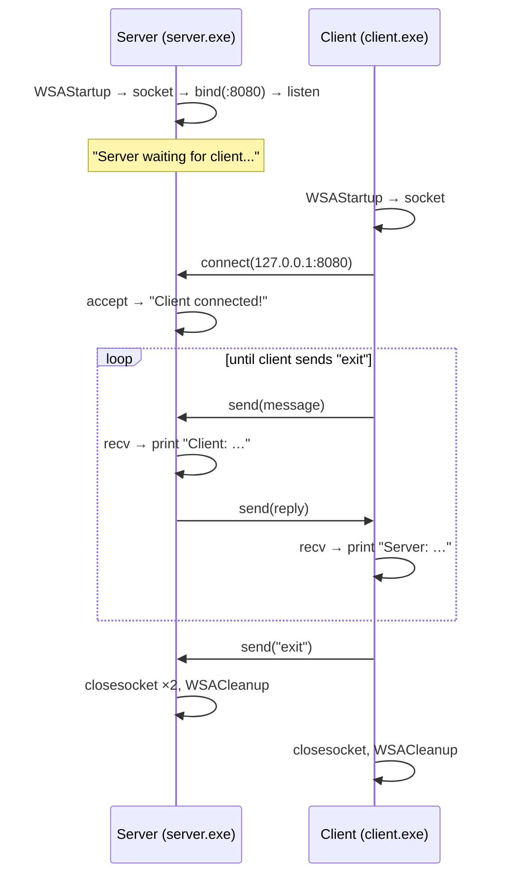

# 💬 Client–Server Chat (C++ · Winsock · TCP)

A minimal two-way chat between a **server** and a **client** over **TCP sockets**, written in C++ with the Windows Sockets API (Winsock 2). The two programs connect on port `8080` and take turns sending text messages from the console until the client types `exit`.

The project is intentionally small (about 100 lines). It is a hands-on walk through the full TCP socket lifecycle: **initialize → socket → bind → listen → accept / connect → send ↔ recv → close**.

---

## Table of contents

- [Features](#features)
- [How it works](#how-it-works)
- [Project structure](#project-structure)
- [Requirements](#requirements)
- [Build](#build)
- [Run](#run)
- [Example session](#example-session)
- [Protocol details](#protocol-details)
- [Limitations](#limitations)
- [Roadmap](#roadmap)
- [What this project demonstrates](#what-this-project-demonstrates)

---

## Features

- **TCP client–server communication** using Winsock 2 (`ws2_32`)
- **Server listens on all interfaces** (`INADDR_ANY`) on port **8080**
- **Turn-based console chat**: client and server alternate messages
- **Graceful shutdown**: the client sends `exit`, both sides close their sockets and call `WSACleanup()`
- **No external dependencies**: only the C++ standard library and the Windows SDK

---

## How it works



### Server (`server.cpp`)

| Step | Call | Purpose |
| --- | --- | --- |
| 1 | `WSAStartup(MAKEWORD(2,2), …)` | Load Winsock version 2.2 |
| 2 | `socket(AF_INET, SOCK_STREAM, 0)` | Create an IPv4 TCP socket |
| 3 | `bind(…, INADDR_ANY, port 8080)` | Attach the socket to port 8080 on every network interface |
| 4 | `listen(…, 1)` | Start listening, with a backlog of one pending connection |
| 5 | `accept(…)` | Block until a client connects; returns a new socket for that client |
| 6 | `recv` → print → read reply → `send` | Chat loop, one message each way per turn |
| 7 | `closesocket`, `WSACleanup` | Release the sockets and Winsock |

### Client (`client.cpp`)

| Step | Call | Purpose |
| --- | --- | --- |
| 1 | `WSAStartup(MAKEWORD(2,2), …)` | Load Winsock version 2.2 |
| 2 | `socket(AF_INET, SOCK_STREAM, 0)` | Create an IPv4 TCP socket |
| 3 | `connect(127.0.0.1:8080)` | Connect to the server on the same machine |
| 4 | read input → `send` → `recv` → print | Chat loop; sending `exit` ends the session |
| 5 | `closesocket`, `WSACleanup` | Release the socket and Winsock |

---

## Project structure

```
Client_Server_Chat/
├── server.cpp    # TCP server: bind, listen, accept, chat loop
├── client.cpp    # TCP client: connect, chat loop, "exit" to quit
└── README.md
```

---

## Requirements

- **Windows** (the code uses Winsock: `winsock2.h`, `ws2tcpip.h`)
- A C++ compiler, either:
  - **MSVC** (Visual Studio / Build Tools), or
  - **MinGW-w64 g++** (for example through MSYS2)

---

## Build

### MinGW-w64 (g++)

MinGW ignores `#pragma comment(lib, …)`, so link Winsock explicitly with `-lws2_32`:

```bash
g++ server.cpp -o server.exe -lws2_32
g++ client.cpp -o client.exe -lws2_32
```

### MSVC (Developer Command Prompt)

The `#pragma comment(lib, "ws2_32.lib")` line links Winsock automatically:

```bat
cl /EHsc server.cpp
cl /EHsc client.cpp
```

---

## Run

Use **two terminals** and start the server first.

**Terminal 1: server**

```bash
./server.exe
```

```
Server waiting for client...
```

**Terminal 2: client**

```bash
./client.exe
```

```
Connected to server!
Client:
```

Type a message in the client and press Enter. Then reply from the server terminal. Type `exit` in the **client** to end the chat.

> If Windows Defender Firewall asks whether to allow `server.exe` on the network, allow it on **Private networks**.

---

## Example session

**Server terminal**

```
Server waiting for client...
Client connected!
Client: hello server
Server: hi! how are you?
Client: all good, bye
Server: bye!
Client: exit
```

**Client terminal**

```
Connected to server!
Client: hello server
Server: hi! how are you?
Client: all good, bye
Server: bye!
Client: exit
```

---

## Protocol details

| Property | Value |
| --- | --- |
| Transport | TCP (`SOCK_STREAM`), IPv4 (`AF_INET`) |
| Port | `8080` |
| Server address | `INADDR_ANY` (all interfaces) |
| Client target | `127.0.0.1` (same machine) |
| Message format | Raw text, no length prefix or delimiter |
| Buffer size | 1024 bytes |
| Turn order | Client → Server → Client → … (half-duplex) |
| End of session | Client sends the exact text `exit` |
| Clients supported | One at a time |

---

## Limitations

This is a learning project, and the current version is deliberately simple:

- **Turn-based only.** Each side must wait for the other's reply before sending again, because `recv()` and `cin.getline()` both block.
- **One client.** The server accepts a single connection and then stops listening for new ones.
- **Localhost only.** The client connects to `127.0.0.1`, so chatting across two computers requires changing the address in `client.cpp` and recompiling.
- **Only the client can end the chat.** Typing `exit` on the server side is sent as a normal message.
- **No error handling.** Return values of `WSAStartup`, `socket`, `bind`, `connect`, `send` and `recv` are not checked. If the port is busy or the other side disconnects, the programs do not report it clearly.
- **Message boundaries are not preserved.** TCP is a byte stream; one `recv()` is assumed to equal one message, which holds for short messages on a local connection but is not guaranteed.
- **Buffer edge case.** `recv()` can fill all 1024 bytes, leaving no room for the terminating `'\0'` before the buffer is printed. Receiving into `sizeof(buffer) - 1` bytes fixes this.
- **Windows only.** Winsock is not available on Linux or macOS.

---

## Roadmap

- [ ] Check every socket call's return value and print `WSAGetLastError()` on failure
- [ ] Handle disconnects (`recv()` returning `0` or `SOCKET_ERROR`)
- [ ] Let either side type `exit`
- [ ] Take server IP and port as command-line arguments
- [ ] **Full-duplex chat**: a separate thread for receiving, so either side can send at any time
- [ ] **Multiple clients** with one thread per client, or `select()`, and broadcast messages to everyone
- [ ] Usernames and timestamps
- [ ] Length-prefixed messages for correct framing
- [ ] Cross-platform build (POSIX sockets on Linux/macOS) with CMake

---

## What this project demonstrates

- The complete **TCP socket lifecycle** on the server and client sides
- **Network byte order** with `htons()` and IPv4 addressing with `sockaddr_in`
- The difference between the **listening socket** and the per-client socket returned by `accept()`
- **Blocking I/O** and why it forces a turn-based conversation
- Winsock setup and teardown with `WSAStartup()` and `WSACleanup()`
